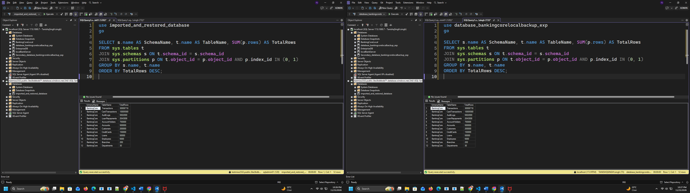
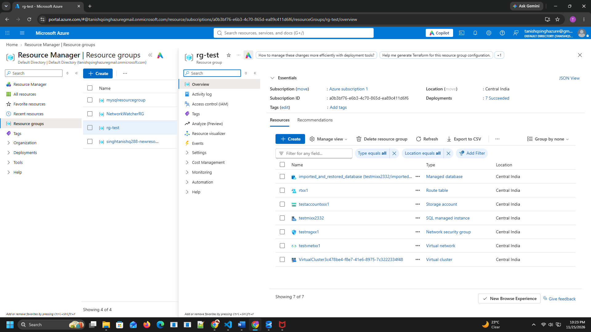
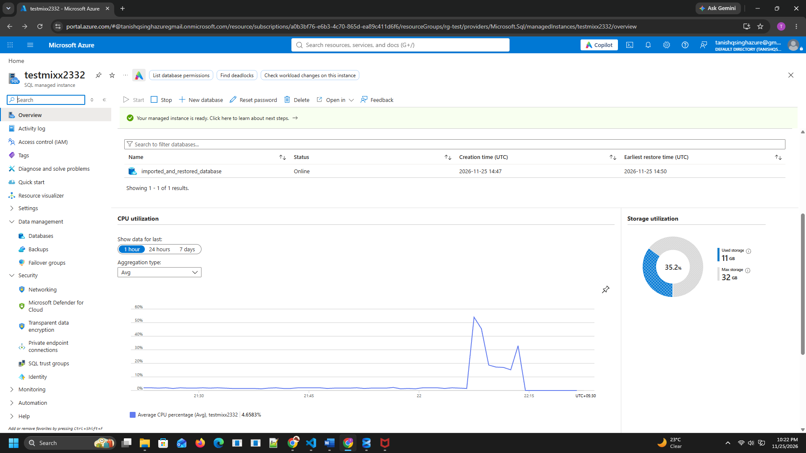
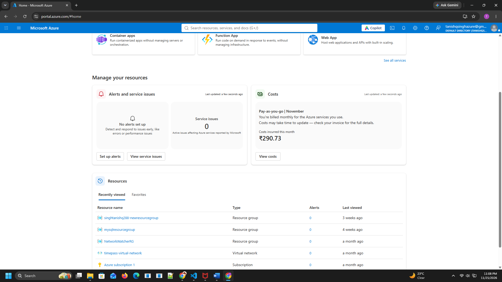

# Migration-On-Prem-SQL-Server-to-Azure-SQL-Managed_Instance

This project demonstrates an end-to-end logical database migration from an on-premises SQL Server (`localhost`) instance to **Azure SQL Managed Instance** using `.bacpac` export/import workflows, modular Azure Bicep templates, and automated CLI scripting.

---

## 📌 Project Overview

* **Assessment & Feasibility:** Evaluated source database compatibility, schema readiness, and Managed Instance feasibility using **Azure Migrate** assessment reports prior to cutover.
* **Infrastructure as Code (IaC):** Provisioned all required cloud networking and compute dependencies (VNet, delegated `/27` subnet, NSGs, User-Defined Route Tables, and Azure SQL Managed Instance) using modular **Bicep** templates.
* **Automation & Migration Tooling:** Used **PowerShell** / batch automation alongside **Azure CLI** and **`SqlPackage.exe`** to export the source database into a compressed `.bacpac` archive and stream it directly into the target Managed Instance over TLS (Port `3342`).
* **Workload Scale:** Validated against a ~15 GB relational banking workload (`45M+` rows across 12 tables) with post-migration row parity (`sys.partitions`), `DBCC CHECKDB` verification, and immediate resource teardown for cost governance.

---

## 📂 Repository Structure

```text
├── Strategy/
│   └── MigrationStrategy.docx        # Complete 5-phase execution plan & runbook
├── bicep_iac/
│   ├── resource_group_config.bicep   # Target resource group provisioning
│   ├── vnet_config.bicep             # Virtual Network configuration
│   ├── subnet_config.bicep           # /27 subnet delegated to Microsoft.Sql/managedInstances
│   ├── nsg_config.bicep              # Inbound/outbound NSG rules (including port 3342)
│   ├── rt_config.bicep               # User-Defined Route Table for Managed Instance traffic
│   └── sqlmi.bicep                   # Azure SQL Managed Instance deployment
├── powershell_scripts/
│   ├── exporting_bacpac.bat          # SqlPackage export script for local SQL Server
│   └── import_and_rebuild.bat        # SqlPackage import & index rebuild script for Azure SQL MI
├── images/
│   ├── row_parity.png                # SSMS row-count validation screenshot
│   ├── resource_group.png            # Deployed Azure resources screenshot
│   ├── mi_dashboard.png              # Azure SQL MI storage & health dashboard
│   └── cost_analysis.png             # Azure Cost Management spend breakdown
└── README.md
```
## 📖 Execution Guide & Strategy

I followed a structured 5-phase runbook to execute this migration safely—covering pre-migration compatibility checks, isolated local backup/export, Bicep infrastructure deployment, bulk import over the Public Endpoint, and post-migration integrity validation.

👉 **Full Runbook:** If you want to replicate or execute this exact migration workflow in your own environment, refer to the complete step-by-step guide in [`./Strategy/MigrationStrategy.docx`](./Strategy/MigrationStrategy.docx).

---

## 🛠️ Prerequisites

* **SQL Server Management Studio (SSMS)** & local **SQL Server** instance
* **Azure Migrate** (for initial compatibility assessment)
* **Azure CLI** (`az`) with Bicep support
* **SqlPackage CLI** (`SqlPackage.exe`)
* Active **Azure Subscription** with quota for General Purpose SQL Managed Instance (4 vCores)

---

## 📊 Migration Metrics & Results

| Metric | Value |
| :--- | :--- |
| **Target Database Size (on Azure SQL MI)** | `11.36 GB` (45M+ total rows across 12 tables) |
| **Compressed `.bacpac` Archive Size** | `1.25 GB` |
| **Export Duration (`SqlPackage`)** | ~15 minutes |
| **Import & Index Rebuild Duration** | ~1.5 hours (via Public Endpoint over residential internet; throughput-dependent) |
| **Total Cloud Spend** | **~₹290 INR** (completed safely under the ₹500 INR lab budget) |
| **Final Target Status** | Online, integrity-verified (`DBCC CHECKDB`), and ready for production queries |

---

## 📸 Proof of Completion & Validation Artifacts

Attached screenshots verify end-to-end execution, data integrity, and cost governance:

### 1. Row-Count Parity
Side-by-side SSMS comparison confirming 100% identical row counts across all 12 tables between the on-premises SQL Server source and Azure SQL Managed Instance target.


### 2. Azure Resource Group Topology
Deployed resources provisioned via modular Bicep (VNet, delegated `/27` subnet, NSG, Route Table, and SQL Managed Instance).


### 3. Azure SQL Managed Instance Dashboard
Live instance health showing `11.36 GB` of consumed database storage post-import and index rebuild.


### 4. Cost Analysis & Governance
Azure Cost Management breakdown confirming the entire deployment, migration, and teardown stayed within **~₹290 INR** (under the ₹500 INR budget).


---

## 💡 Architectural Takeaways & Production Lessons

* **Network Bottlenecks on Logical Migrations:** Uploading a `1.25 GB` compressed `.bacpac` (expanding to 45M+ rows during index rebuilds) over a standard residential internet connection highlights the physical throughput limits of logical migrations.
* **Production Cutover Strategy:** While `.bacpac` over a Public Endpoint is effective for dev/test environments, meeting strict enterprise SLAs (**<30-minute RTO / near-zero RPO**) in production requires:
  * Private connectivity via **ExpressRoute** or **Site-to-Site VPN** (Public Endpoint disabled).
  * An **in-VNet Jumpbox VM** to eliminate public internet latency.
  * Physical log-shipping methods such as **Managed Instance Link** (Distributed Availability Groups) or **Log Replay Service (LRS)** instead of logical `.bacpac` imports.
